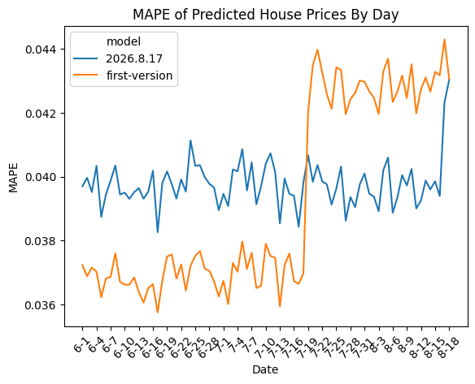

# Home Price ML Pipeline

A home sale price prediction system that retrains itself on new data, built as a set of Docker services around PostgreSQL. A simulator streams synthetic home sales into the database, a scheduled job cleans and enriches them, a training job retrains the model on the new data, and two prediction services serve the original model and the newest one side by side so their errors can be compared as the market changes.

This was built over eleven weeks as a series of milestones in a graduate course on deploying and maintaining ML models. More context is on my portfolio at [billyyork.com](https://billyyork.com).



When the simulated economic conditions shifted in mid-July, the original model's error (MAPE) rose from about 3.7% to 4.3%, while the retrained model held steady near 4%.

## Architecture

| Service | What it does |
| --- | --- |
| [`simulator`](simulator/README.md) | Writes synthetic home sale events, sampled from the King County house sales dataset, into a raw events table. Provided by my instructor. |
| [`cleaning-job`](cleaning-job/README.md) | Every 15 minutes, validates and cleans a batch of raw events and joins in population and public school data by ZIP code. |
| [`training-job`](training-job/README.md) | Retrains the model (a scikit-learn pipeline around a Random Forest) on newly arrived data and stores the serialized model in PostgreSQL. |
| [`prediction-service`](prediction-service/README.md) | Flask API serving the first trained model, on port 8888. |
| [`dynamic-prediction-service`](dynamic-prediction-service/README.md) | The same API serving the newest model from the training job, on port 8889. |
| [`evaluation-pipeline`](evaluation-pipeline/README.md) | Every 15 minutes, sends a batch of cleaned events to a prediction service and records its predictions against the actual sale prices, tagged with the model that made them. |

Every service runs as its own container on a shared Docker network, `home-sale-event-system`, alongside a PostgreSQL container named `postgres`.

## Running it

1. Download the population and school datasets into `data/` (see [data/README.md](data/README.md)).
2. Create the Docker network and start PostgreSQL:
   ```bash
   docker network create home-sale-event-system
   docker run --name postgres --network home-sale-event-system -e POSTGRES_PASSWORD=change-me -p 5432:5432 -d postgres
   ```
3. Create the database and raw events table, then build and start the simulator, following [simulator/README.md](simulator/README.md).
4. Load the population and school tables with the code in [`notebooks/02-data-exploration.ipynb`](notebooks/02-data-exploration.ipynb).
5. Train the first model by running [`notebooks/04-model-development.ipynb`](notebooks/04-model-development.ipynb), which saves it as `milestone4_rf_cmb.pkl`, and copy it to `prediction-service/model.pkl`. The trained models aren't committed because of their size.
6. Build and start the remaining services in the order listed above. Each service's README covers its environment variables and `docker run` command.

## Notebooks

The notebooks document each stage as it was built:

- [`01-setup`](notebooks/01-setup.ipynb) sets up PostgreSQL and the simulator.
- [`02-data-exploration`](notebooks/02-data-exploration.ipynb) explores and cleans the data and loads the population and school tables.
- [`03-cleaning-job`](notebooks/03-cleaning-job.ipynb) builds the batch cleaning and enrichment job.
- [`04-model-development`](notebooks/04-model-development.ipynb) compares five regressors, engineers features, and serializes the final pipeline.
- [`05-evaluation-pipeline`](notebooks/05-evaluation-pipeline.ipynb) builds the evaluation pipeline.
- [`06-training-job`](notebooks/06-training-job.ipynb) adds the training job and compares the original and retrained models.

## Known limitations

- The training data overlaps with the test data, because the simulator re-samples the same ~21,000 King County sales. The Random Forest's R² of 0.993 during development is inflated as a result.
- The dynamic prediction service only loads the newest model when it starts, so a new model isn't used until its container is restarted.
- Credentials are passed as plain environment variables on a single Docker network, rather than through a secrets manager or an orchestrator like Kubernetes.
- The serialized model had to be trimmed until PostgreSQL would accept it. The training job hex-encodes the pickle into the insert statement, which doubles its size, and is probably what ran into the query size limit.

## Credits

The home sale simulator and its copy of the [King County house sales dataset](https://www.kaggle.com/datasets/harlfoxem/housesalesprediction) were provided by my instructor and are licensed under the Apache License 2.0 (see [simulator/LICENSE](simulator/LICENSE)). Everything else is my own work.

## License

MIT, except for the `simulator` directory, which is Apache 2.0.
